  

 

  

---

### `01` // TECH STACK

<table>
  <tr>
    <td width="190"><b>Languages</b></td>
    <td>
      
      
      
      
      
      
      
    </td>
  </tr>
  <tr>
    <td><b>AI &amp; Computer Vision</b></td>
    <td>
      
      
      
      
      
    </td>
  </tr>
  <tr>
    <td><b>Hardware &amp; Robotics</b></td>
    <td>
      
      
      
      
    </td>
  </tr>
  <tr>
    <td><b>Infrastructure &amp; Tools</b></td>
    <td>
      
      
      
      
    </td>
  </tr>
</table>

---

### `02` // FEATURED ENGINEERING PROJECTS

| Project | Domain | Architecture & Highlights |
| :--- | :--- | :--- |
| **KWS ESP32 Voice Control** | `Edge AI / IoT` | On-device keyword spotting on **ESP32-C6** (Mic → MFCC → Tiny CNN), streaming **AES-256** encrypted commands over Wi-Fi to a laptop home-automation server. |
| **ROS2 Line-Follower Buggy** | `Robotics` | Autonomous **B3RB** buggy using `ROS2 / rclpy`: PD control on vision edge-vectors, LIDAR obstacle avoidance, and QR/sign-board detection on CogniPilot/cranium. |
| **Micromouse Wall-Follower** | `Control Systems` | Python wall-following bot (PacBot) in a micromouse simulator, controlled over **MQTT** with ToF sensors, gyroscope feedback, and tuned **PID** control. |
| **Sign Language Recognition** | `Computer Vision` | Real-time static A–Z ASL recognition pipeline (**MediaPipe** hand landmarks → classifier → **Flask** live inference server). |

---

### `03` // TELEMETRY

  

